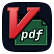

# Vpdf



A Vim-inspired terminal PDF reader powered by [MuPDF][mupdf] and the [Kitty
graphics protocol][kitty].

[![Three PDFs with outline, citation preview, search, and OCR selection][overview]][demo]

Read, navigate, and copy without changing the source PDF. See the [demos][demo]
for reading workflows.

- Navigate and select with Vim-style motions, text objects, or the mouse.
- Search, browse outlines, preview links, and return through marks and history.
- Read multiple documents in tabs or compare independent views in split panes.
- Copy text, capture figures and regions, and export images.
- Read rendered pages or extracted text; recognize scans with optional OCR.
- Save reading positions and reload documents when their PDFs change.

## Start

```sh
brew install letientai299/tap/vpdf
vpdf document.pdf
```

See [terminal setup][setup] for the required graphics and keyboard protocols.

## Help and documentation

Use `vpdf --help` for launch options and `:help` inside the reader for current
keys, mouse gestures, and commands. The [user manual][reading] teaches reading,
searching, copying, and working across documents. The
[documentation index][docs] covers setup, constraints, design, and development.

## License

Vpdf's original code is [MIT-licensed][license]. Executables that include MuPDF
and its Rust bindings remain subject to their AGPL obligations. See [dependency
licensing][notices].

[mupdf]: https://mupdf.com/
[kitty]: https://sw.kovidgoyal.net/kitty/graphics-protocol/
[overview]: https://github.com/user-attachments/assets/2be01fa8-8b03-48c9-b135-32458351aa2a
[demo]: docs/demos.md
[setup]: docs/users/install.md#terminal-setup
[reading]: docs/users/readme.md
[docs]: docs/readme.md
[license]: LICENSE
[notices]: docs/users/install.md#licensing
