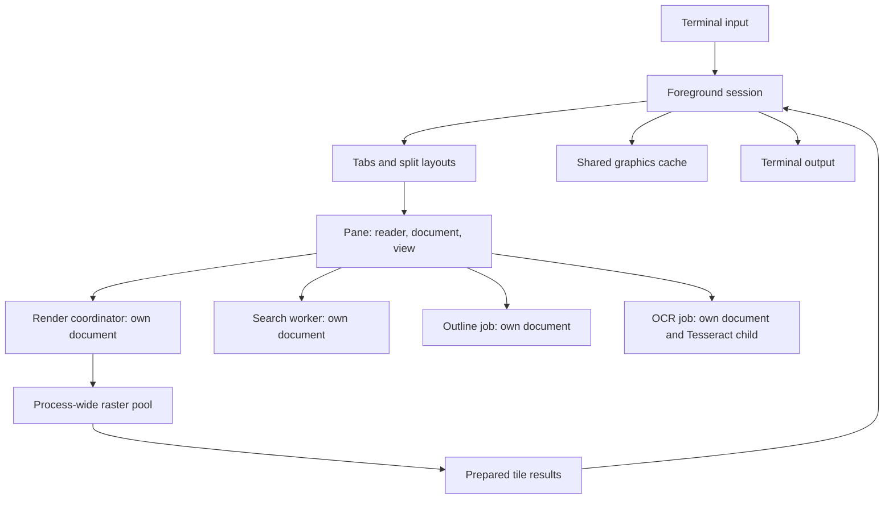

# Reader architecture

vpdf separates reading state, PDF interpretation, and terminal presentation.
The foreground owns interaction and terminal output; workers prepare results
that it can accept, replace, or discard.

## Project principles

- Keep reading keyboard-driven, with composable motions and explicit focus.
- Preserve source PDFs. Store reading state outside the document.
- Keep input responsive by moving rasterization and document scans off the
  foreground thread where possible.
- Reuse page interpretation and pixels before doing more work.
- Bound application caches and background work without promising a hard process
  memory limit.
- Keep extracted-text presentation and make OCR and desktop integrations
  optional.

Use `vpdf --help` and `:help` for the current interface. These principles guide
changes; they do not enumerate the feature set.

## Package boundaries

The root application owns panes, raster dispatch, persistence, and effects. The
[model crate][model] owns shared document values, text reflow, geometry, and
bounded caches. [Search][search-crate] owns indexing and matching over model
text. [PDF][pdf-crate] owns native access, document scans, and derived-content
caches; it depends on model and search. The [reader crate][reader-crate] owns
cursor, motion, selection, registers, and jump semantics over model text, using
search for jump ordinals and hyphen joins. The application adapts native
documents to reader and UI data-access traits. The [UI crate][ui-crate] owns
interface state, transitions, bindings, layout, theme, and drawing; it consumes
model, reader, search, and terminal without native PDF dependencies.

The [terminal crate][terminal-crate] owns capabilities, terminal lifecycle,
graphics delivery, and spool files. It depends on model and the
[protocol crate][protocol], which decodes terminal input bytes into events.
Headless presenters accept explicit transport settings. The
[package guide][packages] defines ownership and dependency enforcement. The
[development guide][development] describes independent tests and benchmarks.

## Runtime ownership

A [session][session] owns tabs, prompt history, saved state, and terminal
output. Each tab contains a split layout and panes; each [pane][app] owns an
independent reader, document handle, view, and worker handles. Two panes showing
the same file still have independent foreground documents and display-list
caches.

Every pane of the active tab receives worker updates and draws. Keyboard input
belongs to the focused pane; pointer routing can target another visible pane.
The session owns the shared graphics cache and passes it to each pane that
draws; images are keyed by pane, and focus changes move nothing. Tabs and panes
share this image budget.

See [sessions and state][sessions] for focus, hidden panes, and persistence.

## Native document boundary

Each [MuPDF handle][document] stays on its owning thread. Workers open separate
handles rather than concurrently using the foreground document. The foreground
and its render coordinator share immutable display lists through a synchronized
cache. The [raster pool][worker] replays these lists with thread-local native
contexts, without taking ownership of the source document.

Cached display lists let text extraction and rasterization reuse page
interpretation. Eviction and concurrent cache misses can require interpretation
again; this is a reuse strategy, not an exactly-once guarantee.

Opening a document still reads page metadata on the foreground thread. Text
needed by a motion may also build a display list there on a cache miss. A slow
native interpretation call can therefore pause interaction. The safe bindings
do not provide preemption of an individual native call.

## Work and resource lifetimes

The latest viewport replaces pending render requests. Search generations keep
superseded queries from changing the current results. Dropping job handles
signals cancellation; an in-flight native call may finish first. [Jobs][jobs]
queue each result before waking the event loop through a callback, so they
never import terminal input.

All MuPDF threads share its global allocation and glyph-cache locks, so a
background text scan slows the view's rasterization and the foreground's text
extraction. Search and outline-inference scans therefore wait between pages
while any pane builds or draws what is on screen. Prefetch does not hold them
back. Decoding stored search indexes takes no MuPDF lock and does not wait;
its concurrency budget comes from the shared [job configuration][jobs].

Hidden panes release rebuildable text, display lists, search workers, and render
coordinators. OCR text and view state remain. The shared graphics cache can keep
their tiles, subject to eviction. Search drops its native handle after idling;
a render coordinator periodically reopens its handle after broad page traversal
to release native resources. The policy and thresholds live in the
[worker implementations][worker] and [search worker][search-worker].

## Design details

- [Rendering][rendering] explains scheduling, transport, and cache accounting.
- [Text and search][text] explains semantic positions and background scans.
- [Development][development] distinguishes CPU measurements from terminal paint
  and display latency.

[session]: ../../src/session/mod.rs
[app]: ../../src/app.rs
[sessions]: sessions.md
[document]: ../../crates/vpdf-pdf/src/document/mod.rs
[worker]: ../../crates/vpdf-pdf/src/jobs/render.rs
[jobs]: ../../crates/vpdf-pdf/src/jobs/mod.rs
[search-worker]: ../../crates/vpdf-pdf/src/jobs/search.rs
[rendering]: render.md
[text]: text.md
[development]: dev.md
[model]: ../../crates/vpdf-model/src/lib.rs
[search-crate]: ../../crates/vpdf-search/src/lib.rs
[pdf-crate]: ../../crates/vpdf-pdf/src/lib.rs
[protocol]: ../../crates/vpdf-protocol/src/lib.rs
[reader-crate]: ../../crates/vpdf-reader/src/lib.rs
[terminal-crate]: ../../crates/terminal/src/lib.rs
[ui-crate]: ../../crates/ui/src/lib.rs
[packages]: packages.md
