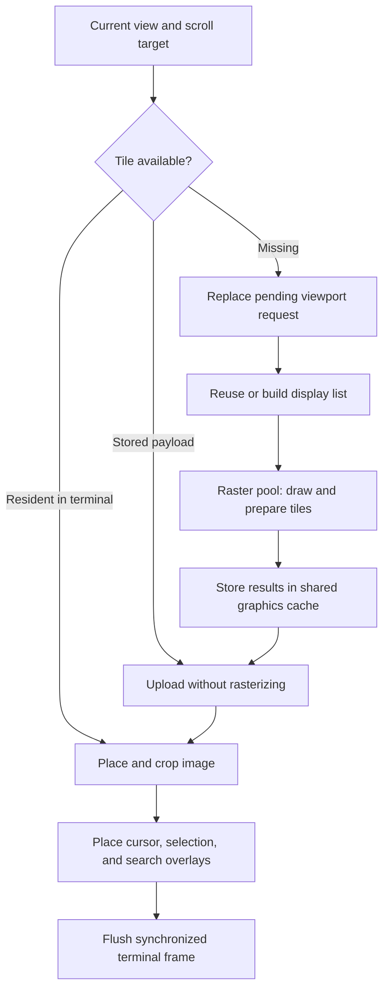

# Rendering and terminal output

MuPDF rasterizes PDF pages on the CPU. The terminal displays those pixels
through the [Kitty graphics protocol][kitty]. Terminal GPU composition does not
make PDF rasterization GPU-backed.

## From viewport to frame

[Layout][layout] maps document coordinates to pixels. [Tile requests][canvas]
cover the visible view and a nearby margin before prefetching farther ahead.
Scrolling requests both the current view and its animation target so that
newly exposed areas can be ready before placement.

The [render coordinator][worker] groups adjacent tiles into horizontal bands.
Replaying a display list for a band amortizes interpretation and replay costs
across its tiles. Prefetch advances one band at a time between urgent requests.
New viewports discard irrelevant queued bands; already running work can finish.

## Image pages

Large embedded images need a different strategy from text pages. MuPDF's image
scaling can depend on clip origin, so independently rasterized tiles can show
seams and repeat image decoding.

The coordinator can render an image-heavy page whole and cut tiles from the
same raster. Whole-page rasterization runs on the pool so it does not hold the
coordinator while a new viewport arrives. Above the whole-page size limit,
[image preparation][prime] decodes large images before band rendering. The
classification and size thresholds belong to the [render worker][worker].

## Reuse and frame scheduling

[Graphics][graphics] keeps prepared payloads separately from terminal-resident
images. Scrolling changes placements and crops; it reuses resident pixels.
Cursor, selection, and match highlights use reusable solid-color images rather
than rerasterizing the page. Returning from a child program invalidates terminal
residency while retaining reusable payloads where available.

The [frame pacer][pace] schedules from deadlines and skips unchanged frames.
Scroll inputs accumulate a target; direct navigation and cancellation interrupt
animation. The requested cadence is an application scheduling goal. Terminal
painting, output transport, and display refresh can limit the observed rate.
See [performance validation][performance] for measurement boundaries.

## Transport choices

Encoded transmission works when the terminal cannot read the reader's files.
When a startup probe confirms file access, the [spool][spool] lets raster
threads write raw pixels to reusable file slots. Upload commands then reference
those slots, avoiding compression and base64 encoding of tile pixels. The spool
lives in the cache directory and is removed on normal terminal cleanup.

Tmux sessions skip the file-access probe and use encoded transmission. Tmux can
answer a device query itself and route a delayed graphics reply to the focused
pane. Graphics commands under tmux suppress replies so they cannot become
another program's input. On direct terminal connections, placements allow error
replies so evicted images can be uploaded again.

[Terminal handling][terminal] wraps graphics in tmux passthrough and uses cell
metrics and pane offsets for placement. Each reader uses a randomized image ID
range and scopes cleanup to it. Shared graphics keys include pane identity so
different views do not overwrite one another's tiles.

Text UI colors follow the terminal palette. Pixel overlays use fixed RGBA
colors; they do not automatically follow the palette.

## Memory accounting

Cache weights bound resources the application can account for; they do not set
a hard RSS limit. Native allocations, in-flight work, and terminal textures have
separate lifetimes. A terminal can also evict images independently.

| Resource                           | Policy and source                                                         |
| ---------------------------------- | ------------------------------------------------------------------------- |
| Extracted and OCR text             | Weighted caches in [Document][document]                                   |
| Display lists                      | Page-count cache in [Document][document]; native byte size is unavailable |
| Search indexes                     | Weighted cache in the [search worker][search]                             |
| Prepared tiles and resident images | Separate budgets in [Graphics][graphics], shared across tabs and panes    |
| Raw pixel spool                    | Fixed-size ring in [Spool][spool]                                         |
| Copied text and registers          | Bounds in [Reader][reader]                                                |

Spooling uses a smaller resident-image budget because reuploading from a file is
cheaper than encoded transmission. Keep numerical limits in their owning source
files so tuning does not leave a second set of constants in the docs.

## GPU rasterization decision

The retained renderer uses MuPDF's CPU rasterizer. A prior GPU prototype did not
replace it: scene conversion, upload, and terminal readback costs matter
alongside raster time, and incomplete PDF drawing coverage or mismatched pixels
prevent mixing renderers safely within a page. The old timing figures are not a
current benchmark baseline.

Revisit this choice only with end-to-end measurements and PDF fidelity checks.
A faster raster stage alone does not establish a faster terminal reader.

[kitty]: https://sw.kovidgoyal.net/kitty/graphics-protocol/
[layout]: ../../src/layout.rs
[canvas]: ../../src/canvas.rs
[worker]: ../../src/render_worker.rs
[prime]: ../../src/prime.rs
[graphics]: ../../src/graphics.rs
[pace]: ../../src/pace.rs
[performance]: dev.md#performance-validation
[spool]: ../../src/spool.rs
[terminal]: ../../src/terminal.rs
[document]: ../../src/document.rs
[search]: ../../src/search_worker.rs
[reader]: ../../src/reader.rs
