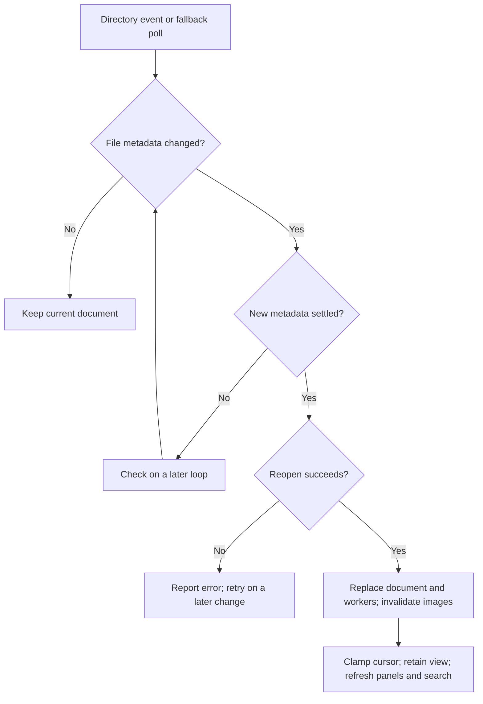

# Sessions and state

A session manages tabs of independently navigable panes. Reading state stays
outside the PDF; viewing, selecting, and inspecting annotations do not save
changes to the source document.

## Panes and focus

[Session][session] owns tab selection and a [split tree][split] for each tab. A
pane holds its own cursor, view, panels, search, and jobs, even when another
pane shows the same file. The split tree controls screen rectangles; the session
routes input and lends the shared graphics cache while drawing visible panes.

Keyboard input belongs to the focused pane. Within it, a focused panel handles
row navigation and search before page motions. [Pointer routing][pointer] uses
the pane under the pointer: clicks can change focus, while wheel scrolling can
leave keyboard focus in place. These boundaries keep one view's navigation from
moving another view accidentally. Use `:help` for pane and focus commands.

Switching tabs trims rebuildable caches and workers in panes that become hidden.
It preserves their view state and retained OCR text. Prepared or
terminal-resident tiles can survive in the shared cache, subject to eviction.
Returning to a tab can therefore reuse pixels without retaining every native
worker resource.

## Persistence

[State][state] stores recent-document positions, view choices, marks, and prompt
history. Per-document entries include cursor position, zoom, rotation, and crop.
Document-local and cross-document marks persist too. This state does not restore
a complete arrangement of tabs, splits, panels, and running jobs.

See [saved state and reload][saved-state] for the state-file location and
user-visible persistence and reload constraints.

The session records changes in memory, saves after an idle period or
periodically during activity, and saves again on exit. [Hangup handling][hangup]
also attempts to save the latest recorded snapshot when the terminal closes.
Abrupt process or machine failure can still lose recent changes.

Saving merges entries and history with the file on disk, then replaces it
through a staged rename. This reduces lost entries between readers and avoids
exposing a partially written JSON file. It does not lock a read-modify-write
transaction across processes; simultaneous saves can still race.

## Live reload

The [watcher][watch] watches parent directories so replacement-by-rename from a
PDF build remains visible. A periodic metadata check covers missed events, and a
settling interval avoids opening files while they are still being written. Only
active-tab panes process reload checks in the event loop; hidden panes check
again when activated.

[Reload][commands] replaces document-derived resources and clamps the cursor to
the new text. It retains view choices and marks, refreshes panels, and reruns a
visible query. OCR text and jump history belong to the old document and are
cleared. The operation preserves a useful reading position; it does not map a
paragraph's identity across arbitrary document edits.

## External actions

[Clipboard delivery][clipboard] owns text and image copying across native
helpers and terminal protocols. See [external actions][external] for
user-visible clipboard, SSH, link, and password behavior.

[session]: ../../src/session.rs
[split]: ../../src/split.rs
[pointer]: ../../src/pointer.rs
[state]: ../../src/state.rs
[hangup]: ../../src/hangup.rs
[watch]: ../../src/watch.rs
[commands]: ../../src/commands.rs
[clipboard]: ../../src/clipboard.rs
[external]: ../reading.md#external-actions
[saved-state]: ../reading.md#saved-state-and-reload
