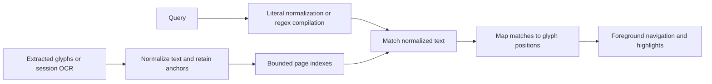

# Text, search, and OCR

Reading operations use extracted glyph positions, independent of how a page is
displayed. This keeps navigation, selection, and search tied to document content
while zoom, crop, rotation, and scrolling change the view.

## Positions and fidelity

The [text model][text] identifies a position by page, line, and glyph.
[Reader operations][reader] use those positions; [layout][layout] projects glyph
bounds onto the screen. Selection copying preserves extracted Unicode and line
boundaries; line-yank operations can join wrapped lines and rejoin hyphenated
words. See `:help` for the joined and unjoined forms. Neither reconstructs the
PDF's original authoring format or reading order.

Native glyph boxes reflect MuPDF extraction. They can differ from corrected
boxes in other PDF wrappers, especially around font ascenders and descenders.
Paragraph motion follows extracted block boundaries rather than inferring prose
structure.

## Search normalization

[Document search][search] favors matches across common PDF text irregularities:
Unicode case and compatibility forms, repeated whitespace, and line-end
hyphenation. A normalized index retains anchors to the extracted glyphs, so a
match can highlight and navigate the original page.

Regular expressions also run on normalized text. Case-sensitive expressions
cannot recover capitals already folded by the index, and character classes see
decomposed forms. The engine supports bounded backtracking; its syntax and cost
model differ from Python's. Use `:help` for query entry and regex activation.

The [search worker][worker] opens its own document and builds indexes lazily.
It sends results incrementally, tags them with query generations, and checks for
supersession between pages. Before reading a page from the PDF, it waits while
on-screen work is in flight; see [scan priority][priority]. Limits cap matches
and regex backtracking. Idling
releases the native handle while keeping cached indexes, so later queries reopen
the PDF only when missing text is needed.

On macOS, or wherever `VPDF_CACHE` points, the worker also keeps page indexes on
disk, in a pack named by the SHA-256 of the PDF's bytes, so reopening an
unchanged file skips extraction. Hashing runs beside the first scan, which reads
the PDF until the pack is known. On APFS, whose file times are exact, a memo
keyed by device, inode, size, and times remembers each file's hash: a reopen
whose pack matches the reader's page count skips hashing, and the PDF opens only
when a page misses, so open errors can arrive with that page. Scans decode
stored pages in batches on a few threads. New indexes save once the worker
idles, unless the file changed since it opened or the pack already holds those
pages. [The content cache][cache] treats any missing, damaged, or stale pack as
a miss and trims the least recently used packs to its budget. OCR text overrides
stored pages; PDFs opened with a password are never stored.

[Panel search][panels] searches displayed rows with its own matching rules.
Do not assume document normalization applies to panel labels.

## Outlines

The [outline job][outline] uses a separate native handle because resolving named
destinations can load much of a large document. An authored outline takes
precedence. If none is available, a bounded scan infers headings from text size
and numbering; like search, it waits while on-screen work is in flight. Inferred
headings are navigation aids and may differ from the author's structure.

The job waits until a frame has placed every tile of the pane's current view,
so its interpretation work cannot delay the first page. Text views start it
after their first frame; hidden panes wait until shown. Opening the outline
panel or moving by section starts it at once, including after `:cancel`.

## Session OCR

[OCR][ocr] supplements pages with no usable text. A worker opens its own
document, rasterizes a bounded page image, and pipes it to a Tesseract
subprocess. The child has cancellation, runtime, and output limits. OCR
rasterization still includes native calls that cannot be interrupted
immediately.

Recognized word boxes yield approximate character positions, rather than
font-specific glyph advances. Results replace extracted text for that page while
retained in the pane's OCR cache and seed an existing search worker. They stay
in memory, can be evicted, and disappear when the document reloads or closes.
The reader never embeds them into the PDF.

See [installation][installation] for the optional OCR dependency and `:help` for
its command interface.

[text]: ../../src/text.rs
[reader]: ../../src/reader.rs
[layout]: ../../src/layout.rs
[priority]: arch.md#work-and-resource-lifetimes
[search]: ../../src/search.rs
[worker]: ../../src/search_worker.rs
[panels]: ../../src/panel_search.rs
[outline]: ../../src/outline.rs
[ocr]: ../../src/ocr.rs
[cache]: ../../src/content_cache.rs
[installation]: ../install.md#optional-helpers
