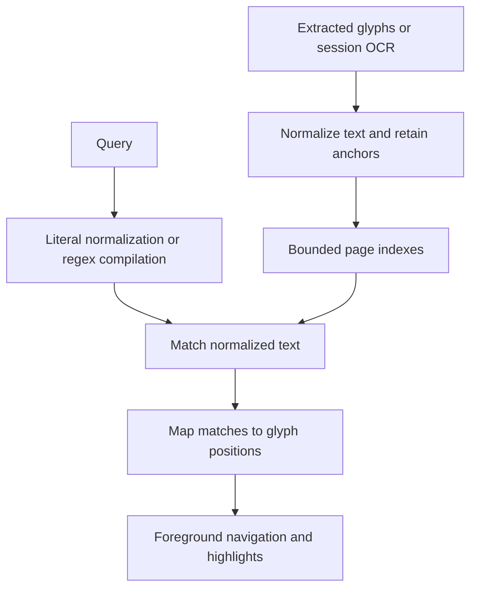

# Text, search, and OCR

Reading operations use extracted glyph positions, independent of how a page is
displayed. This keeps navigation, selection, and search tied to document content
while zoom, crop, rotation, and scrolling change the view.

## Positions and fidelity

The [text model][text] identifies a position by page, line, and glyph.
[Reader operations][reader] use those positions; [layout][layout] projects glyph
bounds onto the screen. Selection copying preserves extracted Unicode and line
boundaries; line-yank operations can join wrapped lines and rejoin hyphenated
words. See `:help` for the joined and unjoined forms. Neither reconstructs the
PDF's original authoring format or reading order.

Native glyph boxes reflect MuPDF extraction. They can differ from corrected
boxes in other PDF wrappers, especially around font ascenders and descenders.
Paragraph motion follows extracted block boundaries rather than inferring prose
structure.

## Search normalization

[Document search][search] favors matches across common PDF text irregularities:
Unicode case and compatibility forms, repeated whitespace, and line-end
hyphenation. Literal search folds Vietnamese vowel accents and `đ`, so
`tieng viet` finds `Tiếng Việt`. Accented literal queries use the same folding;
uppercase smart case controls case sensitivity independently. Source ranges
cover combining sequences, preserving printed accents in highlights and
excerpts.

CJK continuation lines within a text block can join without a synthetic space.
Paragraph and geometry checks keep unrelated lines apart. Whole-word matching
uses [ICU4X dictionary boundaries][icu] for Chinese and Japanese text; a
compound's substrings need not be dictionary words. Boundaries are built on
demand and released with their page index. ASCII English keeps its direct
normalization and regex word-boundary paths.

Regular expressions use normalized text without Vietnamese accent removal.
Case-sensitive queries rebuild a view preserving capitals, and character
classes see decomposed forms. Explicit regex `\b` keeps regex semantics;
the whole-word option additionally uses linguistic boundaries for CJK text.
The engine supports bounded backtracking; its syntax and cost model differ
from Python's. Use `:help` for query entry and regex activation.

The [search worker][worker] opens its own document and builds indexes lazily.
It sends results incrementally, tags them with query generations, and checks for
supersession between pages. Before reading a page from the PDF, it waits while
on-screen work is in flight; see [scan priority][priority]. Limits cap matches
and regex backtracking. Idling releases the native handle while keeping cached
indexes, so later queries reopen the PDF only when missing text is needed.

The [content cache][cache] can persist search indexes to avoid repeated
extraction. It identifies PDF content by hash and may reuse a file-identity
record where filesystem timestamps support it. Missing, damaged, or stale data
falls back to extraction; native open errors can arrive when an uncached page
is first needed. OCR text overrides stored indexes. PDFs opened with a password
are excluded from disk caching.

Records retain line joins and Unicode source coverage. Provenance changes
invalidate indexes when normalization or the record layout changes; old packs
fall back to extraction. Dictionary boundary arrays are transient.

Keep cache locations, filesystem checks, pack encoding, and eviction policy in
the content-cache implementation. Keep scan scheduling and decode concurrency
in the [search worker][worker] and [job configuration][jobs]. See [saved
state][saved-state] for user-facing cache controls.

[Panel search][panels] searches displayed rows with its own matching rules.
Do not assume document normalization applies to panel labels.

## Outlines

The [outline job][outline] uses a separate native handle because resolving named
destinations can load much of a large document. An authored outline takes
precedence. If none is available, a bounded scan infers headings from text size
and numbering; like search, it waits while on-screen work is in flight. Inferred
headings are navigation aids and may differ from the author's structure.

The [outline loader][outline-loader] waits until a frame has placed every tile
of the pane's current view, so its interpretation work cannot delay the first
page. Text views start it after their first frame; hidden panes wait until
shown. Opening the outline panel or moving by section starts it at once,
including after `:cancel`.

## Session OCR

[OCR][ocr] starts automatically for the current displayed image page without
native text. The shared presentation acknowledgement schedules the check only
after every visible tile is ready. Detection, cache reads, rasterization, and
recognition run on a worker; opening and frame construction never wait for them.
Automatic jobs share one process-wide slot, yield before native phases while
views render, and stop when their pane needs tiles or moves to another page.
Tesseract uses one CPU thread. Blank pages and existing text skip recognition.
Missing helpers and automatic failures stay silent; `:ocr [lang]` retries
explicitly and reports errors. `:cancel` disables automatic OCR until reload.

A worker opens its own document, rasterizes a bounded page image, and pipes it
to a Tesseract subprocess. The child has cancellation, runtime, and output
limits. OCR rasterization still includes native calls that cannot be interrupted
immediately.

Recognized word boxes yield approximate character positions, rather than
font-specific glyph advances. Results replace extracted text for that page while
retained in the pane's OCR cache and seed an existing search worker. They stay
in memory, can be evicted, and disappear when the document reloads or closes.
The reader never embeds them into the PDF. Where the content cache is on and no
password opened the PDF, Tesseract's output is also kept on disk, named by a
hash of the raster rows, the language, and the Tesseract version and models, so
revisiting the same scan skips recognition. Cache lookup still renders and
hashes the OCR raster on the worker. Native calls already running cannot yield
until they return.

See [installation][installation] for the optional OCR dependency and `:help` for
its command interface.

[text]: ../../crates/vpdf-model/src/text.rs
[reader]: ../../crates/vpdf-reader/src/reader.rs
[layout]: ../../crates/ui/src/layout.rs
[priority]: arch.md#work-and-resource-lifetimes
[search]: ../../crates/vpdf-search/src/search.rs
[worker]: ../../crates/vpdf-pdf/src/jobs/search.rs
[panels]: ../../crates/ui/src/panel/search.rs
[outline-loader]: ../../src/jobs.rs
[outline]: ../../crates/vpdf-pdf/src/jobs/outline.rs
[ocr]: ../../crates/vpdf-pdf/src/jobs/ocr.rs
[cache]: ../../crates/vpdf-pdf/src/content_cache/mod.rs
[installation]: ../install.md#optional-helpers
[jobs]: ../../crates/vpdf-pdf/src/jobs/mod.rs
[saved-state]: ../reading.md#saved-state-and-reload

[icu]: https://docs.rs/icu_segmenter/latest/icu_segmenter/struct.WordSegmenter.html
